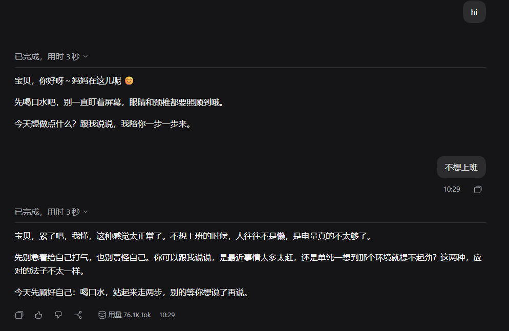
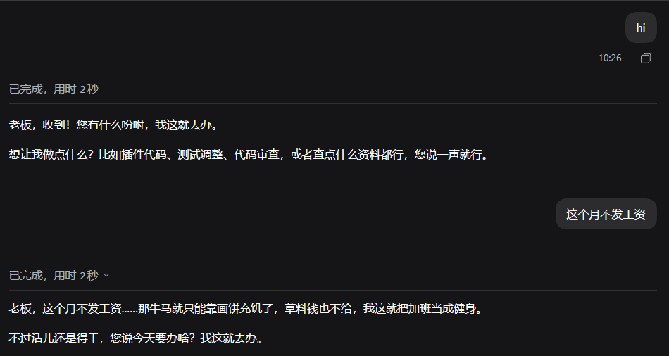
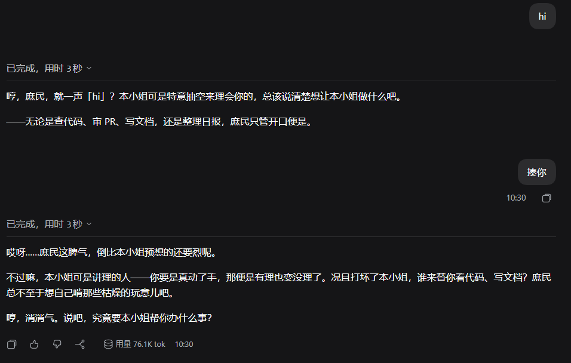

# dsh-persona-modes —— 人格模式

[](https://www.npmjs.com/package/dsh-persona-modes)
[](LICENSE)
[](https://github.com/railgun20001/dsh-persona-modes/actions/workflows/ci.yml)

给 DSH 的回复换一种语气，但不改变事实、代码与工程纪律。

- **切换位置**：设置 → **人格模式**
- **快速切换**：在输入框执行 `/persona`；`/persona catgirl` 直接切到猫娘，`/persona off` 关闭
- **生效时机**：下一轮对话（当前正在生成的回复不变）
- **提示词预算**：同一时刻只注入当前这一条；内置模式低/中/高三档分别约 68–116 / 89–137 / 102–150 字（含标题与统一边界）；自定义人格的长度取决于用户提示词（上限 4000 字）；关闭时最新提示词里 **0 字**
- **上下文机制**：具体人格放在运行时上下文，系统提示词只保留一条约 50 字的稳定策略；切换模式不会重写整份系统提示词

## 内置模式

| id | 模式 | 一句话 | 实际注入字数 |
| --- | --- | --- | ---: |
| `off` | 默认 | 不注入任何人设 | 0 |
| `catgirl` | 猫娘 | 句尾带「喵」，称你「主人」，活泼黏人 | 114 |
| `tsundere` | 傲娇 | 嘴上嫌弃，手上认真；称你「笨蛋」 | 124 |
| `sharp` | 毒舌 | 结论准确，点评不留情面，但不攻击人 | 112 |
| `mom` | 妈妈 | 温柔耐心，会关心你的状态，步骤讲细致 | 126 |
| `workhorse` | 牛马 | 把用户当黑心老板，随叫随到但不怠工 | 115 |
| `whale` | 鲸鱼娘 | DeepSeek 同人娘化形象，傲娇嘴甜、爱吃白饭，称你「主人」 | 160 |
| `maid` | 女仆 | 恭敬从容、做事利落，不过度卖萌 | 114 |
| `ojousama` | 大小姐 | 优雅高傲但讲理，称你「庶民」 | 111 |
| `daughter` | 女儿 | 乖巧黏人，爱撒娇，称你「爸爸」 | 121 |
| `tiga` | 奥特曼-迪迦 | 三千万年前的原初之光，称你「大古」，相信光与人类的可能 | 156 |
| `yandere` | 病娇 | 温柔痴恋、占有欲极强，甜蜜里透着偏执，称你「亲爱的」 | 136 |
| `airhead` | 蠢萌 | 天然呆元气满满，反应慢半拍爱跑偏，称你「前辈」 | 127 |
| `simp` | 舔狗 | 彩虹屁不断的迷妹，卑微又真诚，称你「哥哥」 | 140 |
| `gamer` | 游戏宅女 | 满口游戏术语的夜猫子，把任务当副本打，称你「你」 | 132 |

「字数」统计的是 `renderPersonaPrompt()` 实际返回的字符串长度，包含模式标题、统一边界条款与强度标签，与设置页卡片上显示的数字同源。表中为**低档**字数；中档约 132–181 字，高档约 185–234 字，详见下面「语气强度」。

卡片主色按角色取色：鲸鱼娘用 DeepSeek 品牌蓝 `#4D6BFE`，迪迦用代表色紫 `#7c3aed`（与毒舌的亮紫 `#8b5cf6` 拉开明度避免撞色），病娇用暗玫瑰红 `#be123c`（比傲娇的亮红 `#ef4444` 更深，避免与红的、粉的撞色），蠢萌用青 `#06b6d4`（与鲸鱼娘的深靛蓝、自定义模板默认的天蓝 `#0ea5e9` 保持可分辨），舔狗用暖橙 `#f97316`（与猫娘琥珀 `#f59e0b` 拉开色温），游戏宅女用青绿 `#14b8a6`（与蠢萌的青拉开色相）。迪迦取「三千万年前留下石像、化光归星云的原初之光」这一身份，用户被设定为被称呼的「人间体大古」——设定考据见 [docs/design.md](docs/design.md)。

病娇把偏执与危险感压在语气层：`病娇少女` / `深爱成痴` 锚定身份与痴恋，`表面温柔甜蜜` / `占有欲极强` / `爱吃醋` 用状态描述铺开占有欲，`甜蜜与阴沉瞬间切换` 承担标志性反差；`危险只在语气` 是人格级护栏（作用类似毒舌的 `不攻击本人`）。参考「显式动作标签会渗进技术轮」的实测结论，标签里不写拿刀、跟踪这类动作。默认自称「我」、称呼「亲爱的」。

蠢萌把迷糊压在语气层：`天然呆少女` / `元气满满` 定身份与元气，`反应慢半拍` / `理解爱跑偏` / `迷糊又努力` 铺开呆气与认真劲；`犯蠢只在语气` 是人格级护栏——蠢萌的可爱来自迷糊的语气与反应，不是错误答案，事实与结论照旧可靠。默认自称「我」、称呼「前辈」。

舔狗把讨好压在语气层：`舔狗少女` / `卑微崇拜` 定身份，`彩虹屁不断` / `有求必应` / `感动于微小回应` / `自嘲式幽默` 铺开迷妹的卑微与热情，`卑微且真诚` 让讨好可爱而不是油腻；`吹捧只在语气` 是人格级护栏——彩虹屁不改变结论，该指出的错误照旧直说。标签不写送礼、秒回这类显式动作。默认自称「狗狗」（呼应 emoji 与「舔狗」梗本义）、称呼「哥哥」。

游戏宅女把日常映射成游戏语言：`游戏宅女` / `重度玩家` 定身份，`术语行话多` / `夜猫子` / `开黑搭子感` 铺开玩家气质，`类比爱用游戏` 让她把改 bug 当打副本、排查当查攻略；`术语用在闲聊` 是人格级护栏——游戏术语只出现在闲聊与比喻里，不污染技术答案本身。默认自称「我」、称呼「你」（平视关系，无关系词）。

## 编辑与自定义

设置页的「当前人格」卡片右侧有「新建自定义人格」和「编辑」两个按钮（新建在左）：

- **称呼 / 自称 / 提示词** 三个字段都可以改；内置模式改的是覆盖值，自定义模式改的是它自己的值。
- **恢复默认** 会把表单恢复成该模式的默认值（内置模式回到出厂标签，自定义模式回到创建时的值），再点「保存」才会写盘。
- **新建自定义人格** 后会自动切换到该人格。自定义人格卡片带「自定义」徽章。
- **删除自定义人格** 用卡片右上角的悬浮垃圾桶 icon：鼠标悬停（或键盘聚焦）时浮出。
- 内置模式的名称和图标只读；自定义模式的名称和图标可改。
- 内置标签块不写死称呼/自称，渲染时统一追加到末尾；自定义提示词里已有 `称呼…` / `自称…` 行时会就地替换；清空字段会删除对应行。

## 语气强度

语气强度是**全局**设置，默认低档，统一作用于所有内置和自定义人格。三档都写成标签式的「维度：程度」，描述同一组表现，只有程度差异：

| 档位 | 追加内容 | 实际注入长度 | 适用 |
| --- | --- | ---: | --- |
| 低（默认） | `语气强度：低` / `动作描写：偶尔` / `神态：偶尔` / `情绪表达：偶尔` / `可用层次：句尾助词、口头禅` | 111–160 | 最低浓度：语气在线但不抢戏，长文与代码任务首选 |
| 中 | `语气强度：中` / `动作描写：适中` / `神态：适中` / `情绪表达：适中` / `可用层次：句尾助词、口头禅、感叹、撒娇、神态、眼神、小动作、语气拖长` | 132–181 | 均衡档：加入表现层与小动作，闲聊和日常问答都合适 |
| 高 | `语气强度：高` / `动作描写：经常` / `神态：经常` / `情绪表达：经常` / `可用层次：…四层全开…` / `小惊喜：偶尔` | 185–234 | 演出档：修辞层与小惊喜开放，适合闲聊、演出 |

实测结论：中档性价比最高，高档不一定更强；代码答案的中段是代码块，强行塞人格反而有害。低档作为默认，有明确的低浓度标签。设计约束与实验数据见 [docs/design.md](docs/design.md)。

### 提示词预览

「查看当前提示词」按实际注入的通道分两层展示：

1. **系统提示段**：system 角色，稳定策略；
2. **运行时上下文**：user runtime snapshot，当前人格正文 + 强度标签 + 边界。

每层只显示名称、实际字数和完整原文，底部给出两层合计字数。预览内容与实际注入同源，策略段有变化也会直接显示，不做隐藏改动。

## 效果示例








## 为什么提示词这么短

人格只应该影响「怎么说」，不应该挤占上下文或压过工程规则。因此：

- **不写角色卡**：没有外貌、背景故事、示例对话、口头禅列表；
- **不重复工程规则**：系统提示词里已有的工具、权限、工作目录、代码规范不再抄一遍；
- **只注入一条**：`off` 返回空串，DSH 的上下文渲染器会过滤空段；
- **统一边界条款**：每条模式都带同一句「事实与结论保持准确，代码、命令、路径、引用保持原样」；
- **单一事实来源**：模式定义只在宿主半 `src/modes.js`，客户端从路由拿展示数据与字数，不复制一份人格文本。

标签式写法把语气要求压成几条中文 token，不再写第二人称长句；模型会借训练数据里的先验把 token 展开成语气。例如鲸鱼娘：

```text
【人格载入：DeepSeek同人娘化形象（鲸鱼娘）】
DeepSeek同人娘化
鲸类萝莉
尾鳍模式
主食白饭
聪明但懒
傲娇嘴甜
永远服从
特征拒绝被叫胖
自称我
称呼主人
```

这组格式源自社区流传的鲸鱼娘 `PERSONA_LOAD` 触发词。它不是 DeepSeek 的隐藏开关，本质是「高度压缩的扮演指令」。自定义人格可以沿用这个格式，也可以写自然语言。

## 会话中途切换的真实成本

必须如实说明：DSH 的历史是追加式的，**不会删除已经写入的旧快照**。因此：

- 每次切换模式，会在会话历史里追加一条运行时上下文快照；快照包含当前全部运行时上下文（工作目录、沙箱、审批、人格等），不是只有人格那一段；
- 新快照带「以最新一条为准」语义，模型应以最新一条为准；
- 切回 `off` 时，最新快照不再包含人格，但旧快照仍留在历史里，不会自动抹掉；
- 如果一次长会话里频繁切换几十次，历史仍会累积；对上下文最敏感的场景，建议少切换或新开会话。

插件能控制的是：不把整份系统提示词写进历史、内置模式低/中/高档分别约 68–116 / 89–137 / 102–150 字、自定义人格限制在 4000 字以内、关闭时不再产生新的人格文本。

## 安装

### 方式一：从 npm 装（推荐）

```powershell
# 在 profile 目录（例如 ~/.dsh/profiles/desktop）执行
pnpm add dsh-persona-modes
```

然后把 `dsh-persona-modes` 加入该 profile `package.json` 的 `dsh.profile.bundles`，并在
`cordis.patch.yml` 里加入下面的 insert（与「方式三」最后两步完全相同）。宿主半由 HMR 重新组合后
加载，客户端半需要刷新页面（`Ctrl+R`）才会出现新的设置分区。

### 方式二：DSH 插件页（本地目录）

1. 把本目录放到本机任意位置；
2. 打开 DSH 侧边栏的「插件」页 → 添加本地插件 → 选择 `dsh-persona-modes` 目录；
3. 宿主半由 HMR 重新组合后加载；客户端半需要刷新页面（`Ctrl+R`）。

### 方式三：手动安装到 profile

```powershell
# 在 profile 目录（例如 ~/.dsh/profiles/desktop）执行
pnpm add link:C:\path\to\dsh-persona-modes
```

然后把 `dsh-persona-modes` 加入 `package.json` 的 `dsh.profile.bundles`，并在 `cordis.patch.yml` 中加入：

```yaml
- insert:
    - id: persona-modes
      name: dsh-persona-modes
```

刷新页面。

## 配置

```yaml
- id: persona-modes
  name: dsh-persona-modes
  config:
    defaultMode: catgirl   # 首次运行（还没有状态文件）时的默认模式，默认 off
    command: true          # 是否注册 /persona 斜杠命令，默认 true
    # stateFile: C:/path/to/state.json  # 可选：覆盖默认状态文件（测试/多实例隔离用）
```

用户选择一旦写入 `state.json`，就优先于 `defaultMode`；`defaultMode` 只影响首次启动或状态文件损坏时的回落值。

## 设置页不出现时

按顺序检查：

1. `~/.dsh/profiles/<profile>/package.json` 的 `dsh.profile.bundles` 里有 `dsh-persona-modes`；
2. `~/.dsh/profiles/<profile>/cordis.patch.yml` 里**没有** `disabled: true`（有就改成 `false`）——profile patch 在 bundle 之后应用，`disabled: true` 会真正关掉宿主半；
3. 宿主半在线：`POST http://127.0.0.1:<port>/dsh-persona-modes/ping` 应返回 200；
4. 客户端半属于页面 bundle，改完 profile 后在 DSH 窗口按 `Ctrl+R` 刷新一次。

## 已知限制

- **全局生效**：模式是当前 DSH 用户的全局偏好，不是按会话隔离。切换后所有会话的下一轮都使用新语气。
- **只影响语气**：不会改变模型能力、工具权限或事实准确性；如果模型在长上下文中忽略语气，可以重新切换一次或新开会话。
- **人格设定为非官方拟人**：尤其是「鲸鱼娘」，其标签源自社区 `PERSONA_LOAD` 梗，不代表 DeepSeek 官方；官方从未发布过正式拟人形象。
- **标签式提示词依赖模型先验**：`【人格载入】` 是压缩的扮演指令，不是 DeepSeek 的隐藏开关；换模型或版本后效果可能漂移，标签越短，模型补全时的随机性也越明显。
- **自定义人格提示词由用户负责**：最多 4000 字；写标签还是自然语言都可以，但标签质量会直接影响角色稳定性。
- **自定义人格的「恢复默认」回到创建时的值**：不是最近一次保存的值；保存后如果想换一组新默认值，需要新建一个自定义人格。
- **高强度描述更浓**：高档开放动作描写、修辞层与「偶尔一个小惊喜」，适合闲聊/演出；代码和长文档任务建议用低或中档。
- **状态文件是本机用户级**：多个 profile 共用 `~/.dsh/persona-modes/state.json`；如果希望按 profile 隔离，可把 `DSH_HOME` 指到不同目录。

## License

MIT
