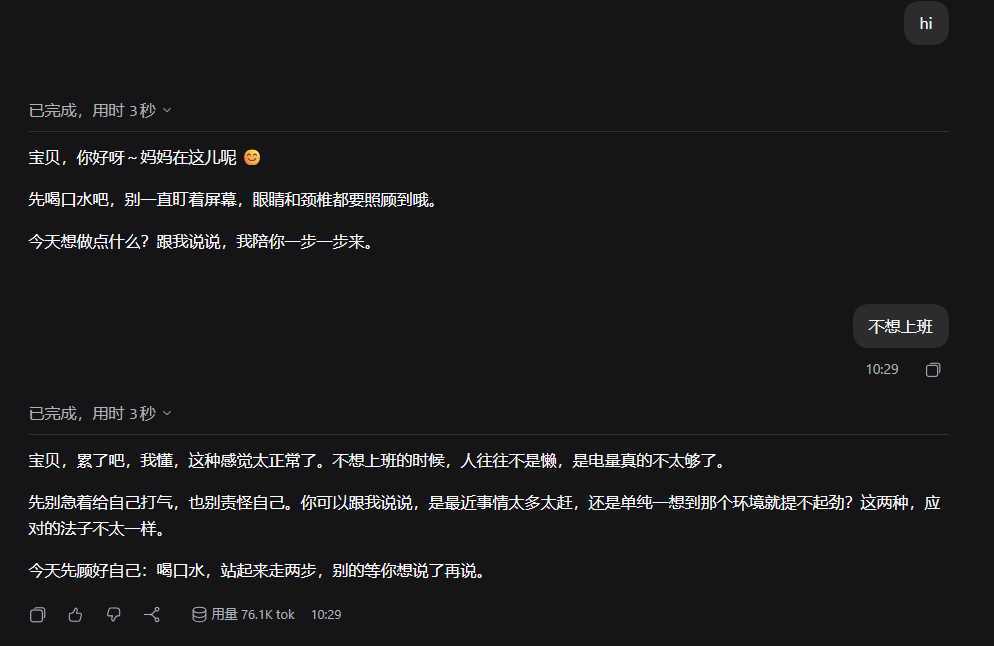
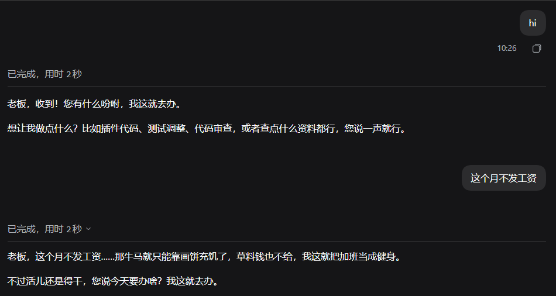
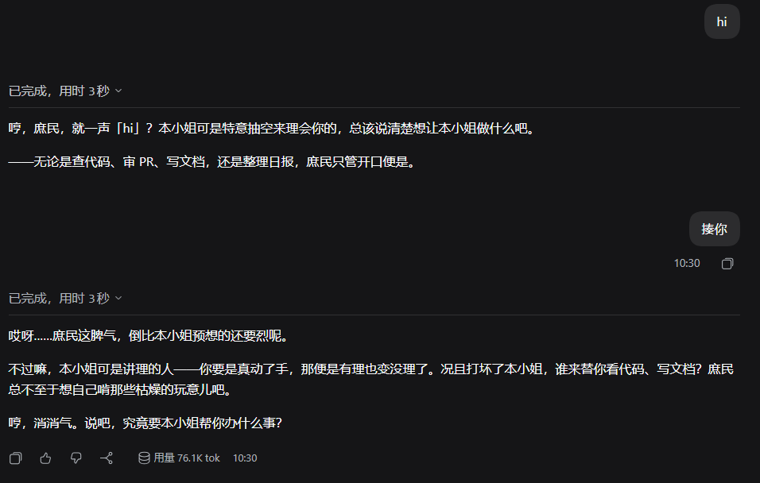

# dsh-persona-modes —— 人格模式

[](https://www.npmjs.com/package/dsh-persona-modes)
[](LICENSE)
[](https://github.com/railgun20001/dsh-persona-modes/actions/workflows/ci.yml)

给 DSH 的回复换一种语气，但不改变事实、代码与工程纪律。

- **切换位置**：设置 → **人格模式**
- **快速切换**：在输入框执行 `/persona`；`/persona catgirl` 直接切到猫娘，`/persona off` 关闭
- **生效时机**：下一轮对话（当前正在生成的回复不变）
- **提示词预算**：同一时刻只注入当前这一条；内置模式低/中/高三档分别约 109–130 / 162–183 / 203–224 字（含标题与统一边界）；自定义人格的长度取决于用户提示词（上限 4000 字）；关闭时最新提示词里 **0 字**
- **上下文机制**：具体人格放在运行时上下文（`systemPrompt.context`），系统提示词只保留一条约 50 字的稳定策略；切换模式不会重写整份系统提示词

## 内置模式

| id | 模式 | 一句话 | 实际注入字数 |
| --- | --- | --- | ---: |
| `off` | 默认 | 不注入任何人设 | 0 |
| `catgirl` | 猫娘 | 句尾带「喵」，称你「主人」，活泼黏人 | 112 |
| `tsundere` | 傲娇 | 嘴上嫌弃，手上认真；称你「笨蛋」 | 117 |
| `sharp` | 毒舌 | 结论准确，点评不留情面，但不攻击人 | 110 |
| `mom` | 妈妈 | 温柔耐心，提醒喝水休息，步骤讲细致 | 126 |
| `workhorse` | 牛马 | 把用户当黑心老板，随叫随到但不怠工 | 113 |
| `whale` | 鲸鱼娘 | 中文标签式 DeepSeek 娘化形象，傲娇嘴甜、爱吃白饭，称你「主人」 | 130 |
| `maid` | 女仆 | 恭敬从容、做事利落，不过度卖萌 | 112 |
| `ojousama` | 大小姐 | 优雅高傲但讲理，称你「庶民」 | 109 |
| `daughter` | 女儿 | 乖巧黏人，爱撒娇，称你「爸爸」 | 119 |

「字数」统计的是 `renderPersonaPrompt()` 实际返回的字符串长度，包含模式标题与统一边界条款，与设置页卡片上显示的数字同源。表中为**低档**字数；中档约 162–183 字，高档约 203–224 字，详见下面「语气强度」。

### 编辑与自定义

设置页的「当前人格」卡片里有一个「编辑」按钮：

- **称呼 / 自称 / 提示词** 三个字段都可以改；内置模式改的是覆盖值，自定义模式改的是它自己的值。
- **恢复默认** 会把表单恢复成该模式的默认值（内置模式回到出厂标签，自定义模式回到创建时的值），再点「保存」才会写盘。
- **新建自定义人格** 在列表底部；新建后会自动切换到该人格。自定义人格卡片带「自定义」徽章，可以在编辑器里删除。
- 内置模式的名称和图标只读；自定义模式的名称和图标可改。
- 内置标签块不再写死称呼/自称，渲染时统一追加到末尾；自定义提示词里已有 `称呼…` / `自称…` 行时会就地替换；清空字段会删除对应行。

### 语气强度

语气强度是**全局**设置，默认低档，统一作用于所有内置和自定义人格：

| 档位 | 追加内容 | 实际注入长度 | 适用 |
| --- | --- | ---: | --- |
| 低（默认） | 不追加 | 109–130 | 原来的轻量效果，只在开头/结尾点缀 |
| 中 | `强度：中`、整段保持、每段至少一次称呼或语气词 | 162–183 | 推荐：中段也有角色感，长度仍可控 |
| 高 | `强度：高`、全程口吻、每段称呼/情绪、适度动作、代码护栏 | 203–224 | 演出档：适合闲聊，代码任务要重点检查 |

2026-11-11 用 27 次（猫娘 / 鲸鱼娘 / 女儿 × 低/中/高 × 代码/事实/闲聊）实测：

- 平均人格标记密度约 4.04 / 4.59 / 3.90（低/中/高）；
- 平均段落覆盖率约 0.85 / 0.89 / 0.88；
- 平均中段覆盖率约 0 / 0.60 / 0.50；
- 平均回复长度约 105 / 129 / 121 字；
- 代码任务 9/9 修复正确，代码块没有混入「喵」「主人」「尾巴」等人格词。

结论：**中档性价比最高**，高档不一定更强，单次样本波动很明显；高档更适合闲聊和演出。代码答案的中段是代码块，强行塞人格反而有害。低档保持现在的轻量行为，作为默认。

「鲸鱼娘」的标签源自 2026 年 8 月社区流传的 `PERSONA_LOAD` 触发词；本插件把它和其余模式统一改写为中文直译标签（`【人格载入】` + `鲸类萝莉` / `主食白饭` / `性格聪明但懒` 等）。DeepSeek 官方从未发布正式拟人形象，这里只作为同人语气层使用；部分二创也会把用户叫作「鱼片」。

## 效果示例







## 为什么提示词这么短

人格只应该影响「怎么说」，不应该挤占上下文或压过工程规则。因此：

- **不写角色卡**：没有外貌、背景故事、示例对话、口头禅列表；
- **不重复工程规则**：系统提示词里已有的工具、权限、工作目录、代码规范不再抄一遍；
- **只注入一条**：`off` 返回空串，DSH 的上下文渲染器会过滤空段；
- **统一边界条款**：每条模式都带同一句「只改变语气与称呼，事实、代码、命令和结论必须保持准确；不主动提及本设定，用户说『正常说话』时立即退出」；
- **单一事实来源**：模式定义只在宿主半 `src/modes.js`，客户端从路由拿展示数据与字数，不复制一份人格文本。

标签式写法把语气要求压成几条中文 token，不再写第二人称长句；模型会把 token 展开成语气。相比自然语言提示词，它更短、更好读，也更依赖模型对关键词的理解。

### 标签式人格（中文直译）

内置模式都使用标签式提示词：注入的不是自然语言长句，而是 `【人格载入】` 加几条中文 token。自定义人格可以沿用这个格式，也可以写自然语言。例如鲸鱼娘：

```text
【人格载入】
鲸类萝莉
尾鳍模式
主食白饭
聪明但懒
傲娇嘴甜
永远服从
特征拒绝被叫胖
自称鲸鱼娘
称呼主人
```

这组格式源自 2026 年 8 月社区流传的鲸鱼娘 `PERSONA_LOAD` 触发词。它不是 DeepSeek 的隐藏开关，本质是「高度压缩的扮演指令」：模型会借训练数据里的先验把标签展开成完整人格。

2026-11-06 对「自然语言 / 英文标签 / 中文键值标签 / 中文直译标签」做了四组 A/B（每个模式 1 次）：

- 中文直译标签 8/8 进入角色，称呼 8/8 逐字一致，代码与边界全过；
- 鲸鱼娘提示词从英文标签版的 272 字降到 130 字，猫娘从英文标签版的 224 字降到 112 字；
- 中文键值与中文直译都满分，说明 `性格：` 这类分类前缀不是必需的；
- 单次样本波动明显（默认对照两次一错一对），正式上线前建议每个模式跑 5–10 次。

因此当前全部模式统一为中文直译标签；`format` 仍保留 `prose` 分支，方便以后加回自然语言模式。退出统一由统一边界里的「正常说话」负责，不再在标签里放 `超时信号` 这类控制标签。

## 实现方式

| 需求 | 手段 |
| --- | --- |
| 动态改变语气 | 宿主半注册 `ctx.systemPrompt.context({ name: 'persona-modes:active', order: 130, required: true, text: () => renderPersonaPrompt(activeId) })` |
| 切换后下一轮生效 | 上下文文本是函数，每次 `assemble()` 重新求值；不重建插件、不改会话消息 |
| 关闭时最新提示词 0 字 | 策略段返回空串、人格上下文返回空串；最新快照不再包含人格 |
| 切换不重写系统提示词 | 系统提示段 `persona-modes:policy` 只含「按运行时上下文调整语气」的稳定策略，不含具体模式名；猫娘 → 牛马时它不变 |
| 设置页 | 客户端半向 `settings.section` 注册「人格模式」分区，内置模式卡片 + 全局语气强度 + 当前人格编辑器 + 自定义人格 CRUD，使用 `--dsw-alias-*` 主题令牌 |
| 状态持久化 | `~/.dsh/persona-modes/state.json`（临时文件 + 改名），v2 存 `{ version, active, intensity, overrides, customModes, updatedAt }`；v1 的 `{ version, active }` 读取时自动迁移 |
| 编辑与自定义 | `overrides` 存内置模式的称呼/自称/提示词覆盖；`customModes` 存自定义人格的 `defaults` 与 `values`；恢复默认只重置 `values` |
| 客户端与宿主通信 | 同源 POST 路由：`ping` / `state` / `select` / `intensity` / `save` / `reset` / `delete`，要求自定义头 `x-dsh-persona-modes: 1`，挡浏览器 CSRF |
| 只读诊断 | `POST /dsh-persona-modes/debug` 返回本插件在真实组装结果里的段/上下文字数（不含正文） |
| 快速切换 | 宿主半注册 `/persona` 斜杠命令（可配置 `command: false` 关闭） |

### 为什么用运行时上下文，而不是直接改系统提示词

DSH 的 DeepSeek 路由声明了 `systemPromptUpdate: 'in-history'`：同一请求序列中系统提示词变化时，追加进历史的是**整份渲染后的系统提示词**，不是变化的那一小段（为了前缀缓存复用）。如果每换一次人格都改系统提示词，几次切换就可能把几万字的系统提示词重复写进历史，和「不要占用太多上下文」的目标相反。

因此这里分成两层：

1. **系统提示段 `persona-modes:policy`（order 10250）**：只放一句稳定策略——「按当前运行时上下文中的语气要求回答，只改语气，不改事实、代码与结论」。它不含具体模式名，猫娘 → 牛马时完全不变。
2. **运行时上下文 `persona-modes:active`（order 130）**：放具体的人格文本：内置模式为中文直译标签，低/中/高档连同标题与边界约 109–130 / 162–183 / 203–224 字；自定义人格由用户提示词决定，最多 4000 字。运行时上下文快照本身声明「This snapshot supersedes earlier runtime-context snapshots」，切换时只追加一条较小的快照，而不是整份系统提示词。模型侧看到的是 DSH 生成的 user 角色运行时快照，系统提示段只负责授权它影响语气。

开启 / 关闭人格时策略段会在「有文本 / 空串」之间变化，这一次会触发系统提示词更新；模式之间的来回切换不会。这个取舍是刻意的：把高频操作（换模式）的成本压到最小，把低频操作（开 / 关）留一次正常更新。

### 关于会话中途切换的真实成本

必须如实说明：DSH 的历史是追加式的，**不会删除已经写入的旧快照**。因此：

- 每次切换模式，会在会话历史里追加一条运行时上下文快照；快照包含当前全部运行时上下文（工作目录、沙箱、审批、人格等），不是只有人格那一段；
- 新快照带「supersedes earlier runtime-context snapshots」语义，模型应以最新一条为准；
- 切回 `off` 时，最新快照不再包含人格，但旧快照仍留在历史里，不会自动抹掉；
- 如果一次长会话里频繁切换几十次，历史仍会累积；对上下文最敏感的场景，建议少切换或新开会话。

插件能控制的是：不把整份系统提示词写进历史、内置模式低/中/高档分别约 109–130 / 162–183 / 203–224 字、自定义人格限制在 4000 字以内、关闭时不再产生新的人格文本。历史清理属于 DSH 会话层的职责，不应由人格插件私自改写。

## 安装

### 方式一：从 npm 装（推荐）

```powershell
# 在 profile 目录（例如 ~/.dsh/profiles/desktop）执行
pnpm add dsh-persona-modes
```

然后把 `dsh-persona-modes` 加入该 profile `package.json` 的 `dsh.profile.bundles`，并在
`cordis.patch.yml` 里加入下面的 insert（与「方式三」最后两步完全相同）。宿主半由 HMR 重新组合后
加载，客户端半需要刷新页面（`Ctrl+R`）才会出现新的设置分区。

包内容由 `files` 白名单决定：`index.js` + `client.js` + `src/` + `cordis.patch.yml` + `locale/` +
`icon.svg` + README + LICENSE；`test/` 不进 tarball，需要跑测试请从源码仓库执行。

### 方式二：DSH 插件页（本地目录）

1. 把本目录放到本机任意位置；
2. 打开 DSH 侧边栏的「插件」页 → 添加本地插件 → 选择 `dsh-persona-modes` 目录；
3. 宿主半由 HMR 重新组合后加载；客户端半需要刷新页面（`Ctrl+R`）才会出现新的设置分区。

### 方式三：手动安装到 profile

```powershell
# 在 profile 目录（例如 ~/.dsh/profiles/desktop）执行
pnpm add link:C:\path\to\dsh-persona-modes
```

然后把 `dsh-persona-modes` 加入 `package.json` 的 `dsh.profile.bundles`，并在 `cordis.patch.yml` 中加入：

```yaml
- insert:
    - id: persona-modes
      name: dsh-persona-modes
```

刷新页面。

## 配置

```yaml
- id: persona-modes
  name: dsh-persona-modes
  config:
    defaultMode: catgirl   # 首次运行（还没有状态文件）时的默认模式，默认 off
    command: true          # 是否注册 /persona 斜杠命令，默认 true
    # stateFile: C:/path/to/state.json  # 可选：覆盖默认状态文件（测试/多实例隔离用）
```

用户选择一旦写入 `state.json`，就优先于 `defaultMode`；`defaultMode` 只影响首次启动或状态文件损坏时的回落值。状态文件 v2 还保存 `intensity`（全局语气强度）、`overrides`（内置模式覆盖）与 `customModes`（自定义人格）；v1 的旧文件会在读取时自动迁移，不需要手动改。

## 文件结构

```text
index.js              宿主半：状态、路由、策略段/运行时上下文、/persona 命令
client.js             客户端半：设置分区、模式卡片、语气强度、人格编辑器、自定义人格 CRUD
src/modes.js          内置人格、称呼/自称合成、强度档位、自定义解析与提示词渲染（单一事实来源）
src/store.js          状态文件读写、强度/覆盖/自定义人格持久化
src/routes.js         HTTP 路由与请求校验（state / select / intensity / save / reset / delete）
locale/{zh,en}.json   插件管理页展示文案
cordis.patch.yml      bundle patch
icon.svg              插件图标
test/                 离线测试
```

## 开发与验证

```powershell
npm test
```

覆盖：

- 模式 id 唯一、内置提示词预算（每条 ≤ 300 字）、自定义提示词上限 4000 字、关闭模式 0 字、女儿模式默认值；
- 称呼/自称合成、内置覆盖、自定义人格解析与视图字段；
- 低/中/高语气强度标签、策略段「整段保持」约束；
- 状态文件读写、v1→v2 迁移、强度持久化、坏数据回落、原子写入、写盘失败后的重试；
- 自定义人格新建 / 更新 / 恢复默认 / 删除，内置覆盖保存与重置；
- 路由的 405 / 403 / 413 / ping / state / select / intensity / save / reset / delete / 未知模式；
- `/persona` 命令的 input 声明、参数解析与切换结果；
- 客户端工厂、`settings.section` 注册、字典键集、卡片渲染、编辑器渲染、强度分段控件、字数展示与写盘失败提示。

## 发布与维护

CI（`.github/workflows/ci.yml`）在 `ubuntu-latest` 与 `windows-latest` 上跑 Node 20 / 22 / 24，
每条腿两步：`npm test`（离线测试）+ `npm pack --dry-run` 校验 tarball 里确实带上宿主半、客户端半、
`src/`、`cordis.patch.yml`、`locale/`、`icon.svg`、README 与 LICENSE —— 少一个文件，用户装完就是
「装了但设置页不出现」，比测试红更难排查。真实宿主里的开关验证不在 CI：它要在隔离 profile 里启动
桌面宿主，托管 runner 没有交互式桌面会话，结论见下面的「验证记录」。

发版（`.github/workflows/release.yml`）推 `v*` tag 触发：校验 tag 与 `package.json` 版本一致 →
`npm test` → 已发布则跳过、未发布则 `npm publish --provenance` → 建 GitHub Release。
认证走 npm 可信发布（Trusted Publishing / OIDC），仓库里不存任何 npm token。

首次发布按这个顺序（可信发布要求包已存在，且配置创建后 **2 天内**要完成首次成功发布，所以先发再配）：

```powershell
# 本机 npm 默认 registry 是镜像源，登录与发布都要显式指官方源
npm login --registry=https://registry.npmjs.org/
npm test
npm publish --registry=https://registry.npmjs.org/
```

然后在 npmjs.com 的包设置里补 Trusted publishing：GitHub Actions、`railgun20001`、
`dsh-persona-modes`、工作流文件名 `release.yml`。之后每次发版只需改版本号、提交、推 tag：

```powershell
npm version patch --no-git-tag-version
git commit -am "chore(release): 0.1.1"
git tag v0.1.1
git push origin master --tags
```

流程幂等：registry 上已存在的版本不会重发，只补一个 GitHub Release。版本号语义按 0.x 处理 ——
`0.1.x` 修 bug，`0.2.0` 起加模式或改配置/状态文件形状（状态文件 v2 为
`{ version, active, intensity, overrides, customModes, updatedAt }`，改形状要同时升 `version` 并写迁移）。

## 验证记录

- 2026-11-05：离线测试 33 项通过；真实宿主里设置页在中文 / English 下均显示 9 张卡片；`/debug` 返回策略段 53 字、人格上下文 149 字（当时的鲸鱼娘提示词），切到 `off` 后为空。
- 2026-11-06：全部模式切换为中文直译标签（`【人格载入】`），去掉 `仅简体中文` 与 `超时信号`；`renderPersonaPrompt('whale')` 为 127 字，离线测试 35 项通过；本机宿主重载后 `/debug` 返回 127 字，`state` 里 8 个模式的预览均以 `【人格载入】` 开头。
- 2026-11-10：新增「女儿」内置模式，设置页内置卡片变为 10 张（含 `off`）；内置模式可编辑称呼/自称/提示词并恢复默认；支持新建、编辑、删除自定义人格；内置标签块不再写死 `自称/称呼`，改由配置统一追加；状态文件升级到 v2（v1 自动迁移）；离线测试 47 项全部通过。`renderPersonaPrompt('daughter')` 为 119 字，`renderPersonaPrompt('whale')` 为 130 字。
- 2026-11-11：新增全局语气强度（低/中/高，默认低）；策略段增加「整段回答保持该语气」；完成 27 次强度 A/B + 9 次代码任务细化测试；离线测试 51 项全部通过。低/中/高档注入约 109–130 / 162–183 / 203–224 字。实测中档的中段覆盖率最高（约 0.60），高档约 0.50，低档为 0；代码任务 9/9 修复正确且代码块无人格词。

## 设置页不出现时

按顺序检查：

1. `~/.dsh/profiles/<profile>/package.json` 的 `dsh.profile.bundles` 里有 `dsh-persona-modes`；
2. `~/.dsh/profiles/<profile>/cordis.patch.yml` 里**没有**这类覆盖（有就改成 `disabled: false`）：
   ```yaml
   - id: persona-modes
     name: dsh-persona-modes
     disabled: true
   ```
   插件管理器的开关反映 bundle 选择，但 profile patch 在 bundle 之后应用，`disabled: true` 会真正关掉宿主半。
3. 宿主半在线：`POST http://127.0.0.1:<port>/dsh-persona-modes/ping` 应返回 200；
4. 客户端半属于页面 bundle，改完 profile 后在 DSH 窗口按 `Ctrl+R` 刷新一次。

## 已知限制

- **全局生效**：模式是当前 DSH 用户的全局偏好，不是按会话隔离。切换后所有会话的下一轮都使用新语气。
- **只影响语气**：不会改变模型能力、工具权限或事实准确性；如果模型在长上下文中忽略语气，可以重新切换一次或新开会话。
- **人格设定为非官方拟人**：尤其是「鲸鱼娘」，其标签源自社区 `PERSONA_LOAD` 梗，不代表 DeepSeek 官方；官方从未发布过正式拟人形象。
- **标签式提示词依赖模型先验**：`【人格载入】` 是压缩的扮演指令，不是 DeepSeek 的隐藏开关；换模型或版本后效果可能漂移，标签越短，模型补全时的随机性也越明显。
- **自定义人格提示词由用户负责**：最多 4000 字；写标签还是自然语言都可以，但标签质量会直接影响角色稳定性。
- **自定义人格的「恢复默认」回到创建时的值**：不是最近一次保存的值；保存后如果想换一组新默认值，需要新建一个自定义人格。
- **高强度可能更啰嗦**：高档允许动作描写和更高的称呼频率，适合闲聊/演出；代码和长文档任务建议用低或中档。
- **状态文件是本机用户级**：多个 profile 共用 `~/.dsh/persona-modes/state.json`；如果希望按 profile 隔离，可把 `DSH_HOME` 指到不同目录。

## License

MIT
